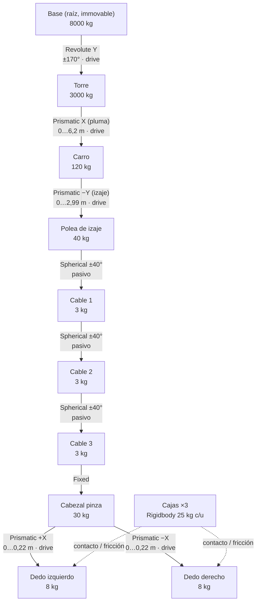

# Simulador de grúa torre con pinza (Articulation Body)

> Encabezado (integrantes, comisión, docente): **completar**.

## 1. Qué máquina y qué operación simula

Simula una **grúa torre pequeña de obra**, del tipo que se usa en edificios de pocos pisos o en grúas autodesplegables:

- torre de unos **6 m** de altura bajo la pluma;
- **pluma de 8,3 m** y contrapluma de 3 m con contrapeso;
- carga máxima de diseño del izaje de unos **200 kg**.

En lugar de un gancho, el aparejo lleva una **pinza de dos dedos**, como las que se usan para mover bloques o pallets.

**Operación:** el operador mueve **3 cajas de 0,5 m y 25 kg** desde la **zona A** (verde) hasta la **zona B** (azul). Para cada caja:

1. gira la torre y desplaza el carro hasta ubicarse sobre la caja;
2. baja el aparejo;
3. cierra la pinza;
4. iza la caja, la traslada y la deposita en la zona B;
5. abre la pinza.

La escena muestra un contador de cajas entregadas, un cronómetro y un botón Reset.

La escena completa la genera un script de Editor: **Tools > Construir Grúa** (archivo `Assets/Grua/Editor/GruaBuilder.cs`). Se usan unidades SI en todo el proyecto: m, kg, s, N.

## 2. Árbol de la articulación

Todos los cuerpos articulados tienen escala (1,1,1). La geometría vive en hijos sin ArticulationBody, y el ancla de cada joint está en el origen del cuerpo, que coincide con el pivote físico.

| # | Cuerpo (padre → hijo) | Joint | Eje (mundo, pose inicial) | Límites | Masa |
|---|---|---|---|---|---|
| 1 | **Base** (raíz) | — (*immovable*) | — | fija al mundo | 8000 kg |
| 2 | Base → **Torre** | Revolute | Y (vertical), en la corona a 1 m de altura | −170° … +170° | 3000 kg |
| 3 | Torre → **Carro** | Prismatic | X (a lo largo de la pluma), a 5,7 m | 0 … 6,2 m (radio 1,5 … 7,7 m) | 120 kg |
| 4 | Carro → **Polea de izaje** | Prismatic | −Y (positivo = baja) | 0 … 2,99 m con 3 eslabones (3,34 con 2; 3,69 con 1) | 40 kg |
| 5 | Polea → **Cable 1** | Spherical (pasivo) | swing en Y/Z del ancla; twist bloqueado | ±40° por eje | 3 kg |
| 6 | Cable 1 → **Cable 2** | Spherical (pasivo) | ídem | ±40° | 3 kg |
| 7 | Cable 2 → **Cable 3** | Spherical (pasivo) | ídem | ±40° | 3 kg |
| 8 | Cable 3 → **Cabezal pinza** | Fixed | — | — | 30 kg |
| 9 | Cabezal → **Dedo izquierdo** | Prismatic | +X local del cabezal (positivo = cierra) | 0 … 0,22 m | 8 kg |
| 10 | Cabezal → **Dedo derecho** | Prismatic | −X local del cabezal (ancla girada 180°) | 0 … 0,22 m | 8 kg |

**Resumen:**

- **10 ArticulationBodies**. Con 1 o 2 eslabones de cable son 8 o 9; se elige en *Tools > Grúa > Construir con N eslabones*.
- **4 tipos de joint:** Revolute, Prismatic, Spherical y Fixed.
- **5 joints con drive controlado:** giro, carro, izaje y los 2 dedos.
- **Partes pasivas:** los eslabones de cable. Solo actúan sobre ellos la gravedad y los contactos.
- **Carga:** las cajas son **Rigidbodies comunes**, no articulados.



### Convención de signos
Todos los joints arrancan en 0 y lo que se ve en pantalla es directamente `jointPosition`:

- giro positivo = horario visto desde arriba;
- carro positivo = hacia la punta de la pluma;
- izaje positivo = el gancho baja;
- dedos positivo = cierran.

La columna "F drive" del panel es la fuerza que reporta PhysX (`driveForce`) en ese mismo eje. Por ejemplo, el izaje muestra una fuerza **negativa** porque tira hacia arriba, contra el sentido positivo (que es bajar).

### Recorrido del izaje
La carrera se calcula para que, con el gancho abajo del todo, la base de los dedos toque justo el suelo:

carrera = 4,04 − 0,35·N m (N = cantidad de eslabones)

Los dedos se centran 0,36 m debajo de la placa del cabezal. Así, con una caja de 0,5 m agarrada por la mitad, quedan 5 cm entre la tapa de la caja y la placa, y la placa no toca la carga.

## 3. Cálculo de los drives (de la raíz hacia la punta)

Todos los drives son de tipo *Force*, con fuerza = k·(target − x) + c·(targetVelocity − v), saturada en `forceLimit`.

El controlador no salta al valor pedido: genera un **perfil trapezoidal**, con velocidad y aceleración máximas, y envía en cada `FixedUpdate` el `target` y la `targetVelocity`. Por eso el resorte solo corrige el error residual.

Para elegir cada drive:

- se fija una frecuencia natural ω y amortiguamiento crítico (ζ ≈ 1);
- de ahí salen k = m·ω² (o I·ω²) y c = 2·ζ·√(k·m);
- `forceLimit` se dimensiona con la fuerza o el torque máximo que el actuador real necesita, más un margen.

Unidades:

- **Giro:** k en N·m/rad, c en N·m·s/rad, límite en N·m. El target se expresa en grados y Unity lo convierte internamente.
- **Lineales:** k en N/m, c en N·s/m, límite en N.

### 3.1 Giro de la torre (Revolute)
El eje es vertical, así que **la gravedad no genera torque**: el motor solo vence la inercia.

| Componente | Masa | Iy respecto del eje |
|---|---|---|
| Mástil (0,6×0,6 m) | 600 kg | ≈ 36 kg·m² |
| Pluma (8,3 m, centro a 4,15 m) | 700 kg | 700·(8,3²/12 + 4,15²) ≈ 16 070 kg·m² |
| Contrapluma (3 m, centro a −1,5 m) | 300 kg | 300·(3²/12 + 1,5²) ≈ 900 kg·m² |
| Contrapeso (a −2,6 m) | 1400 kg | 1400·2,6² ≈ 9 460 kg·m² |
| **Torre** | **3000 kg** | **≈ 26 500 kg·m²** (cargado en `inertiaTensor`) |
| Carro + aparejo + pinza + caja (240 kg) en la punta (7,7 m) | | 240·7,7² ≈ 14 200 kg·m² |
| **Peor caso** | | **I ≈ 40 700 kg·m²** |

- **Rigidez y amortiguamiento:** con ω = 3 rad/s, k = I·ω² ≈ 3,7·10⁵ → **k = 4,0·10⁵ N·m/rad**, y c = 2·I·ω ≈ 2,4·10⁵ → **c = 2,4·10⁵ N·m·s/rad**.
- **Perfil:** velocidad máxima 18°/s (0,31 rad/s) y aceleración 20°/s² (0,35 rad/s²).
- **Torque necesario:** τ = I·α ≈ 40 700·0,35 ≈ 14 200 N·m.
- **forceLimit = 3,0·10⁴ N·m**, unas 2 veces el torque de aceleración. Alcanza para frenar la pendulación de la carga, pero ante un choque el motor se satura en lugar de generar fuerzas absurdas.

### 3.2 Carro (Prismatic horizontal)
Masa movida: carro 120 + polea 40 + cable 9 + cabezal 30 + dedos 16 + caja 25 = **240 kg**. El movimiento es horizontal, así que la gravedad no actúa sobre el eje.

- **Rigidez:** k = 8000 N/m → ω = √(8000/240) ≈ 5,8 rad/s.
- **Amortiguamiento:** c = 2·√(8000·240) ≈ 2770 → **c = 2800 N·s/m** (ζ ≈ 1,0).
- **Perfil:** velocidad 0,8 m/s y aceleración 1,0 m/s², con lo que F = m·a ≈ 240 N.
- **forceLimit = 1500 N.** Cubre la aceleración más la reacción de la carga pendulando, con margen.

### 3.3 Izaje / polea (Prismatic vertical)
Este es el único drive que **sostiene peso**. La masa colgada es polea 40 + cable 9 + cabezal 30 + dedos 16 + caja 25 = **120 kg**, o sea W = 1177 N.

- **Caída estática por gravedad:** con k = **6,0·10⁴ N/m** es W/k = 2,0 cm. Se ve en el panel como diferencia entre target y real.
- **Con la carga máxima de diseño** (200 kg en lugar de la caja): W ≈ 2894 N, caída 4,8 cm.
- **Dinámica:** ω = √(60000/120) ≈ 22 rad/s y c = 2·√(60000·120) ≈ 5370 → **c = 5400 N·s/m** (ζ ≈ 1,0).
- **forceLimit = 4500 N**, unas 1,55 veces el peso con 200 kg de carga. Alcanza para izar acelerando a 1 m/s², pero no para arrancar la grúa si la pinza queda trabada.
- **Perfil:** velocidad 0,6 m/s y aceleración 1,0 m/s².

### 3.4 Cable (Spherical, pasivo)
Los eslabones no tienen drive: stiffness = 0, damping = 0 y forceLimit = 0. Se mueven solo por gravedad, por la inercia de la carga y por los contactos.

- Masa de 3 kg por eslabón, que incluye el grillete.
- Inercia fija de 0,04 kg·m², para evitar inercias diminutas.
- Twist bloqueado y swing limitado a ±40°.

**Disipación pasiva (no son drives):**

- **`jointFriction` = 0,3 en cada rótula.** Representa el rozamiento del grillete y la rigidez a la flexión del cable. **Es imprescindible:** con fricción 0 la cadena se vuelve numéricamente inestable (pendulados de 30–40° a más de 1000°/s, medido en la prueba automática). Con 0,05 ya es estable.
- **`angularDamping` = 0,6** en los eslabones.
- **`linearDamping` = 0,8** en el cabezal y los dedos. Es un arrastre equivalente, mayor que el aerodinámico real, elegido para que el operador no tenga que esperar más de unos 8 s a que la carga deje de pendular. En una grúa real ese trabajo lo hace el operador "acompañando" la carga.

**Decaimiento del pendulado** con una caja agarrada, tras desplazar el carro 2 m. Cada columna es el rango del ángulo de swing en una ventana de 2 s:

| Configuración | 0–2 s | 2–4 s | 4–6 s | 6–8 s | 8–10 s | 10–12 s |
|---|---|---|---|---|---|---|
| **Elegida** (fricción 0,3; linDamp 0,8) | 0,7–5,5° | 0,3–2,3° | 0,2–1,4° | 0,1–0,6° | 0,1–0,3° | 0,1° |
| linDamp 0,4 | 0,3–4,2° | 0,3–3,0° | 0,3–2,4° | 0,3–1,7° | 0,3–1,1° | 0,3–0,7° |
| Fricción 0,05 | 0,1–4,2° | 0,1–2,6° | 0,1–2,0° | 0,1–1,2° | 0,1–0,7° | 0,1–0,4° |
| Fricción 0 | 6,8–31,2° | 8,6–34,0° | 3,6–27,4° | … inestable | | |

### 3.5 Cabezal (Fixed)
Une rígidamente el último eslabón con el bastidor de la pinza. Masa: 30 kg.

### 3.6 Dedos de la pinza (Prismatic)
Los dedos se mueven en horizontal, así que la gravedad no actúa sobre su eje. Lo que importa es la **fuerza de apriete**.

**Fuerza normal mínima** para sostener la caja de 25 kg (W = 245 N) con dos caras de contacto, μ = 0,8 y factor de seguridad 2:

N ≥ 2·W / (2·μ) = 2·245 / (2·0,8) ≈ **307 N**

**Diseño elegido: el apriete lo da el resorte del drive.**

- El target de cierre es 0,22 m y la caja toca a los 0,135 m, así que queda un error de 0,085 m.
- Con **k = 6000 N/m**, cada dedo aprieta N = 6000·0,085 ≈ **510 N** (más de 307 N, con margen).
- La capacidad de fricción es 2·μ·N = 2·1,0·510 ≈ 1020 N, unas 4 veces el peso. Con μ = 0,8 sería 816 N, más de 3 veces.
- **forceLimit = 800 N** por dedo. Es el techo de seguridad: aunque algo trabe la pinza, nunca aprieta más que eso, así que no atraviesa la caja ni la hace saltar.
- **c = 440 N·s/m**: c = 2·√(6000·8) ≈ 440, con ω ≈ 27 rad/s y ζ ≈ 1.
- El cierre va a 0,25 m/s. En la prueba automática, la caja nunca superó 0,10 m/s al cerrar la pinza.

**Por qué no saturar el drive directamente.** Primero probé con k = 20 000 N/m y forceLimit = 500 N, de modo que el drive quedaba siempre saturado. Con los dos dedos empujando con la misma fuerza constante, la caja queda en **equilibrio neutro** a lo largo del eje de la pinza: se observó que derivaba hasta que un dedo llegaba a su tope (0,07 m vs. 0,20 m). Con el resorte (sin saturar), si la caja se corre hacia un lado, el dedo de ese lado aprieta menos y el otro más, lo que da una **fuerza restauradora que la centra**. En la prueba, los dedos quedan en 0,134–0,136 m.

### 3.7 Tabla resumen

| Joint | Tipo | Stiffness | Damping | forceLimit | Velocidad / aceleración máx. | Por qué |
|---|---|---|---|---|---|---|
| Giro torre | Revolute | 4,0·10⁵ N·m/rad | 2,4·10⁵ N·m·s/rad | 3,0·10⁴ N·m | 18°/s, 20°/s² | Inercia de hasta 40 700 kg·m²; ω = 3 rad/s con amortiguamiento crítico; límite ≈ 2× el torque de aceleración |
| Carro | Prismatic | 8000 N/m | 2800 N·s/m | 1500 N | 0,8 m/s, 1,0 m/s² | 240 kg movidos; ω ≈ 5,8 rad/s, ζ ≈ 1 |
| Izaje | Prismatic | 6,0·10⁴ N/m | 5400 N·s/m | 4500 N | 0,6 m/s, 1,0 m/s² | Sostiene 120 kg con 2 cm de caída; límite ≈ 1,55× el peso con la carga máxima de 200 kg |
| Cable ×3 | Spherical | 0 | 0 | 0 | — | Pasivo (solo gravedad y contacto); fricción de rótula 0,3 |
| Cabezal | Fixed | — | — | — | — | Unión rígida |
| Dedo izq./der. | Prismatic | 6000 N/m | 440 N·s/m | **800 N** | 0,25 m/s, 1,0 m/s² | Apriete por resorte de ≈ 510 N (hacen falta 307 N) que autocentra la caja; techo de 800 N |

**Otros parámetros:**

- El giro tiene `jointFriction` = 0. En PhysX esa fricción es proporcional a la fuerza de reacción del joint, y la torre soporta varias toneladas, así que con 0,05 aparecía un error estático de ~0,5°.
- Carro, polea y dedos usan 0,05.

## 4. Configuración física

- **Paso fijo y solver:** 0,01 s (100 Hz), con paso máximo de 0,05 s. Solver **TGS** con 12/4 iteraciones; la raíz de la articulación usa 20/4.
- **Materiales físicos:**

  | Material | μ estático / dinámico | Combinación |
  |---|---|---|
  | Goma de la pinza | 1,0 / 0,9 | Maximum |
  | Caja de madera | 0,6 / 0,5 | Average |
  | Suelo | 0,7 / 0,6 | Average |
  | Acero | 0,4 / 0,3 | Average |

  El rebote es 0 en todos.
- **Cajas:** Rigidbody de 25 kg con interpolación, colisión *ContinuousSpeculative* y `maxDepenetrationVelocity` de 2 m/s.
- **Colisiones internas:** los cuerpos de la grúa ignoran las colisiones entre sí.

## 5. Controles

| Acción | Teclado | UI |
|---|---|---|
| Girar la torre | A / D o ← / → | Slider "Giro torre" |
| Carro afuera / adentro | W / S o ↑ / ↓ | Slider "Carro" |
| Bajar / subir el gancho | E / Q | Slider "Izaje (polea)" |
| Abrir / cerrar la pinza | Espacio (alterna) | Sliders "Dedo izquierdo" y "Dedo derecho" |
| Modo prueba sin drives | — | Toggle (panel de controles) |
| Reiniciar la tarea | — | Botón **Reset** |
| Orbitar la cámara | Clic derecho + arrastrar | — |
| Zoom | Rueda del mouse | — |
| Vista inicial | R | — |

**Paneles en pantalla:**

- **Controles:** muestra el target y el valor real de cada drive debajo de su nombre.
- **Articulaciones — target vs. real:** lista todas las articulaciones (incluidos los eslabones pasivos con sus dos ángulos de swing y el cabezal Fixed) y la fuerza o el torque que ejerce cada drive.
- **Tarea:** contador, cronómetro y Reset.
- **Instrucciones.**

### Modo prueba sin drives
Pone stiffness y damping en 0 en los 5 drives:

- el **izaje cae por gravedad hasta su límite inferior** y se detiene ahí, lo que demuestra que los límites funcionan;
- los ejes horizontales (giro, carro y dedos) quedan libres, sin ningún motor que los sostenga.

Al desactivarlo, los targets arrancan desde la posición real de cada joint para no dar un tirón.

## 6. Cómo se completa la tarea

1. Girá la torre (A/D) hacia la zona A (verde, a −50°) y llevá el carro (W) hasta quedar sobre una caja.
2. Esperá a que el cable deje de pendular y bajá el gancho (E) hasta que los dedos queden a la altura de la caja.
3. Cerrá la pinza (Espacio). En el panel se ve la fuerza de apriete de cada dedo, de unos 500–700 N.
4. Subí el gancho (Q), girá hacia la zona B (azul, a +60°) y bajá la caja hasta apoyarla.
5. Abrí la pinza (Espacio) y subí el gancho.
6. La caja cuenta como **entregada** cuando su centro está dentro de la zona B, no toca la grúa y queda quieta (v < 0,05 m/s) durante 1 s. Cuando las 3 están entregadas aparece **"¡Tarea completa!"** con el tiempo, y el cronómetro se detiene.

## 7. Verificación automática

`Tools > Grúa > Ejecutar prueba automática` (o `PruebaGrua.Ejecutar` en batchmode) simula sin entrar en Play:

1. el modo sin drives;
2. un escalón de cada drive;
3. la tarea completa con las 3 cajas.

La prueba de la tarea opera como lo haría una persona: se ubica sobre la caja, espera a que el cable deje de pendular, baja, cierra la pinza, iza, traslada, espera, baja, abre y sube.

Corrí la prueba con 1, 2 y 3 eslabones y las tres pasaron (tiempos de tarea de 168 s, 159 s y 151 s). Esta es la salida con 3 eslabones (Unity 6000.3.19f1, batchmode):

```
=== 1) MODO PRUEBA SIN DRIVES ===
  Giro torre       real=   0,000°  límites [-170, 170]  dentro
  Carro            real=   0,000 m  límites [0, 6,2]  dentro
  Izaje (polea)    real=   2,990 m  límites [0, 2,99]  dentro
  Dedo izquierdo   real=   0,001 m  límites [0, 0,22]  dentro
  Dedo derecho     real=   0,001 m  límites [0, 0,22]  dentro
  Izaje cayó hasta su límite inferior: sí
  Al reactivar drives, deriva del izaje en 2 s: 0,0 mm
=== 2) RESPUESTA DE LOS DRIVES ===
  Giro torre        0,00 →   90,00°: llegó en 5,8 s, sobrepaso 0,80°, error final 0,18°
  Carro             0,01 →    5,00 m: llegó en 7,0 s, sobrepaso 8 mm, error final 9 mm
  Izaje (polea)     0,01 →    2,50 m: llegó en 4,7 s, sobrepaso 14 mm, error final 13 mm (caída por peso)
  Giro torre       90,00 →  -60,00°: llegó en 9,1 s, sobrepaso 0,96°, error final 0,27°
  Error de seguimiento máx. en movimiento: giro 1,10°, carro 2,5 cm, izaje 1,5 cm
=== 3) TAREA COMPLETA (3 eslabones de cable) ===
  Caja 1/2/3: izadas 2,38 m, v máx al cerrar la pinza ≤ 0,10 m/s, las tres quedaron en la zona B
  Mayor espera (en el aire) hasta que el cable deja de pendular: 8,9 s
  Entregadas: 3/3, tarea completa: True, cronómetro 151,2 s
RESULTADO GLOBAL: OK
```

**Cómo leer los resultados:**

- En el izaje, el error final de unos 13 mm es la caída estática por el peso colgado: W/k = 1177/60 000 ≈ 2 cm a plena carga.
- El sobrepaso del giro (< 1°) se debe a la inercia de la carga pendulando.
- La tarea es **repetible**: la simulación es determinista y los agarres quedan centrados.
- `Tools > Grúa > Ejecutar prueba automática` deja el informe en `Logs/prueba_grua.txt`.
